# FlowCard AWS CI/CD Operational Runbook

## Overview

Run commands from the repository root. This runbook defines the end-to-end
procedure for executing, monitoring, and rolling back FlowCard AWS demo releases.

For current readiness and acceptance status, use
[`demo-operations.md`](demo-operations.md) and
[`demo-acceptance.md`](demo-acceptance.md). This workflow runbook describes
release sequencing. `deploy-demo.sh` verifies backend services only;
`deployed_and_verified` is written after frontend publication and invalidation
completion.

## Release Governance Boundaries

1. **Trigger Mechanism:** Explicit manual activation via `workflow_dispatch`
   only. Automatic push deployments are strictly disabled.
2. **Approved Branch & Pinned Commit:** `develop` branch only. All jobs checkout
   and pin the exact trigger commit (`${{ github.sha }}`) to prevent moving
   branch race conditions. Releases from other branches fail closed immediately.
3. **Manual Authorization:** The privileged job requires `confirm_approval`
   to be true and runs only for a manual dispatch on `refs/heads/develop` in
   `slabarcaf/flowcard-treasury`.
4. **OIDC Trust:** AWS requires the repository's immutable owner and repository
   IDs plus the exact `develop` branch subject. Job-scoped `id-token: write`
   remains limited to the privileged deployment job.
5. **Concurrency Serialization:** All releases are serialized using
   `concurrency: { group: "aws-demo-release", cancel-in-progress: false }`.
   Releases queue rather than cancel in progress.
6. **No Secrets in Logs or Manifests:** All secrets remain in AWS Secrets
   Manager; zero secret plaintext appears in GitHub artifacts, logs, or
   command-line arguments.
7. **Runtime Approval:** Ramil approved the four environment names
   (`ONBOARDING_SERVICE_URL`, `ONBOARDING_SERVICE_SECRET`,
   `S3_BUCKET_DOCUMENTS`, `S3_KMS_KEY_ID`); standard loaders consume them and
   demo rollout inputs enable the integration. The November 12 operator
   checkpoint reports values provisioned and services deployed. Verify current
   runtime state through approved release evidence; this offline change made
   no AWS calls.

---

## Toolchain & Quality-Gate Architecture

The unprivileged verification job (`validate-and-test`)
enforces:

- **Terraform:** Version `1.10.5` (conforming to
  `required_version = ">= 1.10.0"` across all root and module configurations).
- **Go:** Version `1.27.3` read directly from
  `services/company-onboarding/go.mod`.
- **Node.js:** Version `20.19.0` (matching Node `>= 20.19.0` project standard).
- **Test Database Isolation:** Dedicated `postgres:16-alpine` service container
  running on port `54329` with `POSTGRES_DB: flowcard_onboarding_test` and
  health checks (`pg_isready`).
- **OpenAPI Freshness:** `go run ./cmd/openapi -check` executed in
  `services/company-onboarding` to prevent schema drift.
- **Strict Baseline Test Gate:** `node infra/scripts/check-test-baseline.js`
  verifies zero unexpected test regressions, runner crashes, unhandled errors,
  or aborted runs while permitting only the documented 23 baseline test
  failures.
- **Infrastructure Formatting:** `terraform fmt -check -recursive infra`
  verifies formatting across all infrastructure scopes (`bootstrap/`,
  `modules/`, `environments/demo/`).

---

## Pre-Release Deployment Procedure

```mermaid
flowchart TD
    Start([Operator triggers workflow_dispatch on develop]) --> InputCheck{confirm_approval == true?}
    InputCheck -- No --> Abort1[Fail closed: input required]
    InputCheck -- Yes --> BranchCheck{Branch == develop?}
    BranchCheck -- No --> Abort2[Fail closed: develop branch only]
    BranchCheck -- Yes --> Job1[Job 1: Validate, Lint & Test]

    subgraph Job1_Details [Job 1: Unprivileged Quality Gate]
        L1[npm run lint]
        B1[npm run build & server:build]
        O1[OpenAPI freshness: go run ./cmd/openapi -check]
        G1[go test -v -race against Postgres:54329]
        T1[Strict baseline test gate: check-test-baseline.js]
        TF1[terraform fmt -check -recursive & validate]
        S1[python3 infra/scripts/verify-offline-safety.py]
    end

    Job1 --> Job1_Details
    Job1_Details --> Job2[Job 2: Build Artifacts & Manifest]

    subgraph Job2_Details [Job 2: Immutable Artifact Preparation]
        D1[Verify Docker builds: Node . and Go company-onboarding]
        F1[npm run build: frontend assets & compute sha256]
        M1[Generate immutable release-manifest.json]
        SUM1[Write Step Summary for operator review]
        UP1[Upload artifacts: frontend-dist, release-manifest]
    end

    Job2 --> Job2_Details
    Job2_Details --> Gate{Manual dispatch confirmation and release gates pass?}

    Gate -- No --> Stop[Workflow halted: no deployment executed]
    Gate -- Yes --> Job3[Job 3: Deploy Demo with OIDC]

    subgraph Job3_Details [Job 3: Privileged Execution]
        CHK1[Verify commit SHA and frontend checksum against manifest]
        OIDC1[Assume AWS Deployer Role via OIDC]
        ECR1[ECR login with aws ecr get-login-password stdin]
        BLD1[Build & push containers from pinned source]
        DEP1[Execute deploy-demo.sh --oidc: Migrations -> Seed -> ECS Services]
        DEP2[Execute deploy-frontend.sh --oidc: S3 sync -> CloudFront invalidation]
    end

    Job3 --> Job3_Details
    Job3_Details --> FrontendGate[Wait for CloudFront invalidation]
    FrontendGate --> Finalize[Finalize Successful Frontend and Backend Release]
    Finalize --> Success([Release metadata marked deployed_and_verified])
```



---

## Step-by-Step Release Instructions

### Step 1: Triggering the Release

1. Navigate to the GitHub repository: `slabarcaf/flowcard-treasury`.
2. Click the **Actions** tab.
3. Select **AWS Demo Deployment** from the workflow list.
4. Click **Run workflow**:
   - **Use workflow from:** Select `develop`.
   - **Explicit human authorization flag:** Check `confirm_approval` (set to
     `true`).
5. Click the green **Run workflow** button.

### Step 2: Unprivileged Validation & Build Phase

The workflow automatically executes two unprivileged jobs:
1. `validate-and-test`:
   - Runs linting and TypeScript compilation.
   - Verifies OpenAPI specification freshness.
   - Runs Go unit and integration tests against isolated PostgreSQL 54329.
   - Executes `check-test-baseline.js` against the Vitest suite (verifies zero
     unexpected failures beyond the 23 documented baseline tests).
   - Validates OpenTofu / Terraform configurations across all scopes.
   - Executes `verify-offline-safety.py` to confirm all offline safety
     invariants hold.
2. `build-and-metadata`:
   - Checks out the exact trigger commit (`${{ github.sha }}`).
   - Verifies container builds for `linux/amd64` architecture (matching AWS
     Fargate `X86_64`) using faithful build contexts (`.` for Node,
     `services/company-onboarding` for Go).
   - Builds the frontend bundle and computes its SHA-256 checksum.
   - Generates an immutable `release-manifest.json`.
   - Publishes a markdown Step Summary on the workflow run page.

### Step 3: Operator Review and Approval Gates

1. The operator opens the workflow run page.
2. Review the **FlowCard Demo Release Manifest** in the Step Summary:
   - Verify the git commit SHA corresponds to the approved `develop` commit.
   - Verify the frontend bundle checksum.
   - Verify that `enable_proposed_onboarding_integration` is `false`.
   - Confirm the foundation artifact checksum, ancestor commit, reviewed
   content digest, review reference, and runtime configuration approval.
   Pending values block deployment.

### Step 4: Privileged Release Execution

Once the foundation, runtime, and provenance gates pass, the `deploy-demo` job
executes:
1. Checks out the exact same trigger commit (`${{ github.sha }}`).
2. Downloads `frontend-dist` and verifies its SHA-256 checksum matches the
   reviewed manifest checksum before any cloud mutation.
3. Assumes the scoped deployer IAM role via GitHub OIDC federation.
4. Logs into Amazon ECR using `aws ecr get-login-password` piping directly to
   `docker login --username AWS --password-stdin` (zero leaked tokens).
5. Builds and pushes container images to ECR and resolves immutable `sha256:`
   digests.
6. Executes `deploy-demo.sh --oidc`:
   - Verifies STS caller account matches the authorized 12-digit AWS account ID.
   - Registers new task definition revisions containing the immutable digests.
   - Runs Node database migrations and verifies exit code 0.
   - Runs Go database migrations and verifies exit code 0.
   - Runs the idempotent synthetic fixture seed task.
   - Updates the ECS services (`flowcard-demo-go-api`,
     `flowcard-demo-go-worker`, `flowcard-demo-node-gateway`) and scales
     `desired_count` to target.
   - Awaits ECS service stability and verifies running task definitions and
     container counts.
7. Executes `deploy-frontend.sh --oidc`:
   - Verifies S3 bucket ownership and CloudFront distribution ownership + OAC
     origin.
   - Uploads immutable assets (`/assets/*`) with `max-age=31536000, immutable`.
   - Uploads non-hashed public assets with `max-age=86400`.
   - Uploads `index.html` with `max-age=0, must-revalidate`.
   - Submits a CloudFront cache invalidation targeting exact changed paths
     (`/index.html`, `/`, `/vite.svg`, etc., never `/*`).
   - Waits for the invalidation to complete. A missing invalidation ID or failed
     waiter leaves release metadata pending.
8. Finalizes `.dev/.release-metadata/deployed-release.json` only after both backend
   health checks and frontend invalidation complete. The finalizer checks the
   account, region, source commit, and frontend checksum before marking the
   release successful.

---

## Coordinated Coupled Rollback Runbook

If a release encounters failures during or after deployment, follow this coupled
rollback procedure using `infra/scripts/rollback-release.sh`.

The workflow does not fetch frontend artifacts from prior runs. Before local
rollback, download the recovery metadata and `frontend-dist` artifacts from the
specific successful run, verify the run attempt and checksum, and use the local
frontend directory. Do not proceed when either artifact is missing or expired.

### Automatic Rollback Boundary

- Database migrations are **NEVER automatically reversed or downgraded**.
  Reversing database migrations automatically risks data loss or schema
  corruption.
- Persistent storage in PostgreSQL (RDS) and document uploads in S3 are strictly
  preserved.

### Coordinated Rollback Execution

The coordinator script `infra/scripts/rollback-release.sh` executes a coherent,
two-phase coupled rollback:

1. **Phase 1 (Backend ECS Services):** Reverts ECS services to exact
   previous task definition revisions via `rollback-demo.sh`. Verifies all 3
   services reach steady state at previous revisions.
2. **Phase 2 (Frontend Static Assets):** Redeploys the previous verified
   frontend build directory via `deploy-frontend.sh` and waits for CloudFront
   invalidation completion.
3. **Coupled Verification:** Both phases must succeed; if either fails, reports
   a critical diagnostic without falsely claiming "all restored".

The workflow currently uploads `frontend-dist` for 14 days and
`release-recovery-metadata` for 90 days. The release metadata records the
workflow run and attempt as the frontend artifact identity. The workflow does
not download artifacts from an earlier run; its dispatch path inputs do not
retrieve cross-run files. For local recovery, identify the successful run,
download its `frontend-dist` and `release-recovery-metadata` artifacts, compare
the build checksum to the successful manifest, then pass those local paths to
`rollback-release.sh`. Keep this recovery manual until cross-run artifact
retrieval is implemented and reviewed.

```bash
# From an authorized local operator session after downloading and verifying
# the prior successful run's recovery metadata and frontend artifact:
infra/scripts/rollback-release.sh \
  --profile "<approved-profile>" \
  --confirm-approval \
  --account-id "<12-DIGIT-ACCOUNT-ID>" \
  --region "us-west-2" \
  --manifest "<RECOVERY_DIR>/deployed-release.json" \
  --frontend-build-dir "<FRONTEND_DIR>"

# Or specifying explicit revisions and frontend build:
infra/scripts/rollback-release.sh \
  --profile "<approved-profile>" \
  --confirm-approval \
  --account-id "<12-DIGIT-ACCOUNT-ID>" \
  --region "us-west-2" \
  --node-revision "<PREVIOUS_NODE_REVISION>" \
  --api-revision "<PREVIOUS_API_REVISION>" \
  --worker-revision "<PREVIOUS_WORKER_REVISION>" \
  --frontend-build-dir "/path/to/previous/dist" \
  --bucket "<FRONTEND_BUCKET_NAME>" \
  --distribution-id "<CLOUDFRONT_DISTRIBUTION_ID>"
```

### ECS desired_count Ownership & Terraform Drift

- In Terraform (`infra/modules/ecs/variables.tf`), `service_desired_count`
  defaults to `0` to support safe pre-image bootstrap foundation provisioning.
- Release automation (`deploy-demo.sh`) updates and scales services to target
  desired count (default `1`).
- In Terraform (`infra/modules/ecs/main.tf`), ECS services include `lifecycle {
  ignore_changes = [desired_count] }` to ensure subsequent infrastructure plans
  do not scale down active running services.
