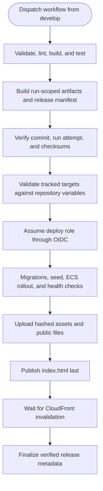

# FlowCard AWS CI/CD Operational Runbook

## Overview

Run commands from the repository root. This runbook explains how to start and
monitor a FlowCard AWS demo release and how to handle a partial failure.

For current readiness and acceptance status, use
[`demo-operations.md`](demo-operations.md) and
[`demo-acceptance.md`](demo-acceptance.md). This workflow runbook describes
release sequencing. `deploy-demo.sh` verifies backend services only;
`deployed_and_verified` is written after frontend publication and invalidation
completion.

## Release Contract

- **Manual trigger, no form fields:** `workflow_dispatch` is the only trigger.
  A dispatch authorizes the release; the workflow has no approval checkbox or
  other manual inputs. Push and pull-request triggers are disabled.
- **Repository and branch:** Jobs run only for
  `slabarcaf/flowcard-treasury` on `develop` and checkout the exact trigger
  commit (`${{ github.sha }}`).
- **Target configuration:** The pinned commit supplies
  `infra/environments/demo/foundation-outputs.json`. Before OIDC, the workflow
  validates its account, region, and resource references against the existing
  repository Actions variables.
- **OIDC trust:** AWS requires the immutable repository IDs and exact
  `develop` branch subject. `id-token: write` is scoped to the deployment job.
- **Serialized releases:** `aws-demo-release` concurrency queues releases and
  does not cancel one already running.
- **Secrets:** Runtime values stay in AWS Secrets Manager and are resolved by
  ECS tasks. They do not appear in Git, workflow artifacts, logs, or command
  arguments.
- **Runtime configuration:** The four names
  (`ONBOARDING_SERVICE_URL`, `ONBOARDING_SERVICE_SECRET`,
  `S3_BUCKET_DOCUMENTS`, `S3_KMS_KEY_ID`) are approved and consumed by the
  standard loaders. The November 12 operator checkpoint reports provisioning;
  it is historical operator evidence, not acceptance of this workflow. This
  documentation update makes no AWS calls.

---

## Toolchain & Quality-Gate Architecture

The unprivileged verification job (`validate-and-test`)
enforces:

- **Terraform:** Version `1.10.5` (conforming to
  `required_version = ">= 1.10.0"` across all root and module configurations).
- **Go:** Version `1.27.3` read directly from
  `services/company-onboarding/go.mod`.
- **Node.js:** Version `20.19.0` (matching Node `>= 20.19.0` project standard).
- **Test Database Isolation:** Dedicated `postgres:16-alpine` service container
  running on port `54329` with `POSTGRES_DB: flowcard_onboarding_test` and
  health checks (`pg_isready`).
- **OpenAPI Freshness:** `go run ./cmd/openapi -check` executed in
  `services/company-onboarding` to prevent schema drift.
- **Strict Baseline Test Gate:** `node infra/scripts/check-test-baseline.js`
  verifies zero unexpected test regressions, runner crashes, unhandled errors,
  or aborted runs while permitting only the documented 23 baseline test
  failures.
- **Infrastructure Formatting:** `terraform fmt -check -recursive infra`
  verifies formatting across all infrastructure scopes (`bootstrap/`,
  `modules/`, `environments/demo/`).

---

## Pre-Release Deployment Procedure

---

## Release Procedure

### Start a release

1. Open **Actions** in `slabarcaf/flowcard-treasury` and select **AWS Demo
   Deployment**.
2. Click **Run workflow** and select `develop` under **Use workflow from**.
3. Click **Run workflow**. There are no input fields; dispatching the workflow
   starts the release.
4. Follow the run page. Validation must pass before the build job publishes
   run-scoped artifacts and a manifest. The deploy job verifies provenance,
   checksums, and the tracked foundation configuration against repository
   variables before requesting OIDC credentials.

The build summary and `release-manifest.json` record the commit, run ID, run
attempt, logical release identity, artifact names, and frontend checksum. The
deploy job records immutable image digests and task-definition revisions.
Inspect `.dev/.release-metadata/deployed-release.json` after the workflow
completes.

### Deployment sequence

After the pre-deployment checks, the workflow assumes the scoped deployer role
through OIDC, pushes the already-built container archives to ECR, and deploys
by the returned image digests. `deploy-demo.sh` runs Node and Go migrations,
the idempotent synthetic seed, and the ECS service rollout. It records
`backend_verified_frontend_pending` only after backend health checks pass.

`deploy-frontend.sh` verifies the target bucket and distribution, then publishes
to the existing S3 paths in this order:

1. Hashed files under `/assets/` with immutable cache headers.
2. Other public files at their existing root-relative paths.
3. `index.html` at the fixed root key, last.

The script retains older S3 objects and invalidates only mutable paths. It waits
for CloudFront invalidation completion. The finalizer records
`deployed_and_verified` only after frontend publication, invalidation, backend
health, target account and region, commit, and checksum verification succeed.

### Release identity and retries

The logical release identity is `<full-commit-sha>/<run-id>-<run-attempt>`.
Artifacts and ECR tags use a safe hyphenated form that includes the attempt.
The provenance check compares build metadata with the current deployment
attempt. If a failed-jobs-only retry reuses an earlier build, it fails before
OIDC. Select **Re-run all jobs** to rebuild artifacts and deploy from one
matching attempt. Separate build and deployment attempt identities are not
supported.

## Partial Failure and Separate Recovery

The workflow does not automatically roll back a release. Inspect the last
completed phase and recovery metadata. A backend-verified release with a
pending frontend is not a successful release. A failed phase may leave backend
services and frontend content at different revisions; preserve the manifest,
logs, database, and S3 data, then stop for operator assessment. Database
migrations are never automatically reversed.

The workflow does not download artifacts from earlier runs. A separately
authorized operator considering manual recovery must select a known successful
run and attempt, download its recovery metadata and frontend artifact, and
verify the commit, identity, and frontend checksum before using the standalone
`infra/scripts/rollback-release.sh`. Its `--manifest` option reads the legacy
`.previous_release.*` layout; a current workflow manifest has no
`previous_release` object and cannot be passed directly. For current metadata,
review the `.services` revisions and `.frontend` checksum, bucket, and
distribution, then supply those explicit targets with the existing CLI flags
and the matching downloaded build. See `demo-operations.md` for the mapping.
The frontend artifact is retained for 14 days, the build manifest for 30 days,
and recovery metadata for 90 days. Missing or mismatched files are a stop
condition. Manual recovery is outside normal release dispatch; the workflow has
no previous-release inputs.

### ECS desired_count Ownership & Terraform Drift

- In Terraform (`infra/modules/ecs/variables.tf`), `service_desired_count`
  defaults to `0` to support safe pre-image bootstrap foundation provisioning.
- Release automation (`deploy-demo.sh`) updates and scales services to target
  desired count (default `1`).
- In Terraform (`infra/modules/ecs/main.tf`), ECS services include `lifecycle {
  ignore_changes = [desired_count] }` to ensure subsequent infrastructure plans
  do not scale down active running services.
