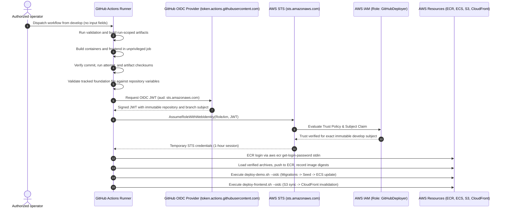

# GitHub Actions AWS OIDC Federation & Least-Privilege IAM Architecture

## Overview

FlowCard utilizes OpenID Connect (OIDC) identity federation between GitHub
Actions and AWS Identity and Access Management (IAM). This architecture
eliminates long-lived AWS access keys in GitHub Secrets, replaces static
credentials with short-lived STS credentials (1-hour validity), and enforces
strict immutable repository, branch, and audience boundaries.

## Architecture & Trust Boundary



## IAM OIDC Provider & Trust Policy

The OpenID Connect provider and deployer IAM role are defined in
`infra/modules/oidc/main.tf` and wired into the demo environment in
`infra/environments/demo/main.tf`.

### IAM OIDC Provider

- **URL:** `https://token.actions.githubusercontent.com`
- **Client ID / Audience:** `sts.amazonaws.com`
- **Thumbprint:** GitHub Actions root CA thumbprint

### Role Trust Relationship Policy

The deployer role (`aws_iam_role.github_deployer`) strictly enforces:

```json
{
  "Version": "2012-10-17",
  "Statement": [
    {
      "Effect": "Allow",
      "Principal": {
        "Federated": "arn:aws:iam::<ACCOUNT_ID>:oidc-provider/token.actions.githubusercontent.com"
      },
      "Action": "sts:AssumeRoleWithWebIdentity",
      "Condition": {
        "StringEquals": {
          "token.actions.githubusercontent.com:aud": "sts.amazonaws.com",
          "token.actions.githubusercontent.com:sub": "repo:slabarcaf@207892885/flowcard-treasury@1427370701:ref:refs/heads/develop"
        }
      }
    }
  ]
}
```

Key guarantees:
1. **Repository Bound:** Restricted to immutable owner ID `207892885` and
   repository ID `1427370701`.
2. **Branch Bound:** Restricted strictly to `refs/heads/develop`.
3. **Audience Bound:** Restricted strictly to `sts.amazonaws.com`.

## Scoped Least-Privilege Deployer IAM Policy

The deployer policy (`aws_iam_policy.github_deployer`) is tightly scoped to the
operations used by the normal `deploy-demo.sh` and `deploy-frontend.sh` release
path. The standalone recovery script is outside normal workflow dispatch and
requires a separate operator authorization:

### 1. IAM PassRole Scope

- **Actions:** `iam:PassRole`
- **Resources:**
  - ECS Task Execution Role ARN:
    `arn:aws:iam::<ACCOUNT_ID>:role/flowcard-demo-execution-role`
  - ECS Task Role ARN:
    `arn:aws:iam::<ACCOUNT_ID>:role/flowcard-demo-task-role`
- **Condition:** `iam:PassedToService = "ecs-tasks.amazonaws.com"`
- **Security Boundary:** The deployer role CANNOT pass roles to EC2, Lambda, or
  any service other than ECS tasks.

### 2. Zero Secrets Access

- **Actions:** `secretsmanager:GetSecretValue` is **strictly omitted**.
- **Security Boundary:** The CI deployer role has zero access to database
  credentials or application secrets. Secrets are resolved exclusively by ECS
  container tasks at runtime via the execution role.

### 3. Zero RDS Admin Access

- **Actions:** `rds:*` master admin permissions are **strictly omitted**.
- **Security Boundary:** The CI deployer cannot modify database instances,
  security groups, or master users. Database migrations run inside ephemeral ECS
  Fargate tasks using container networking.

### 4. Narrow Service Release Scopes

- **Amazon ECR:** Scoped strictly to `var.ecr_repository_arns` (all 4 service
  repositories) with **zero wildcard fallback**.
- **Amazon ECS Service Updates:** Scoped to `ecs:UpdateService` and
  `ecs:DescribeServices` on the exact 3 demo service ARNs and cluster ARN.
- **Amazon ECS Task Execution (`ecs:RunTask`):** In accordance with AWS IAM
  service authorization specifications, `ecs:RunTask` is scoped strictly to the
  exact Task Definition ARNs:
  - Node migration:
    `arn:aws:ecs:<REGION>:<ACCOUNT>:task-definition/`
    `flowcard-demo-node-migration:*`
  - Go migration:
    `arn:aws:ecs:<REGION>:<ACCOUNT>:task-definition/`
    `flowcard-demo-go-migration:*`
  - Synthetic seed:
    `arn:aws:ecs:<REGION>:<ACCOUNT>:task-definition/`
    `flowcard-demo-synthetic-seed:*`
  Conditioned on `ArnEquals: { "ecs:cluster": "<CLUSTER_ARN>" }`.
- **Amazon EC2 Network Discovery:** Scoped to `ec2:DescribeSubnets` and
  `ec2:DescribeSecurityGroups`. As documented in AWS service authorization,
  EC2 Describe actions do not support resource-level permissions and require
  `Resource = "*"`.
- **Amazon S3:** Scoped to frontend static asset deployment (`s3:PutObject`,
  `s3:GetObject`, `s3:ListBucket`) on the frontend bucket ARN with expected
  bucket owner check.
- **Amazon CloudFront:** When CloudFront is enabled, distribution verification
  (`cloudfront:GetDistribution`), invalidation creation
  (`cloudfront:CreateInvalidation`), and completion polling
  (`cloudfront:GetInvalidation`) use the exact distribution ARN. The statement
  is omitted when CloudFront is disabled, with no wildcard fallback. AWS lists
  `distribution` as the supported resource for all three actions in the
  [CloudFront Service Authorization Reference](https://docs.aws.amazon.com/service-authorization/latest/reference/list_cloudfront.html).

---

## State Access Governance: Release Outputs Artifact vs State

- In ambient OIDC CI execution, `deploy-demo.sh` does NOT require access to the
  remote Terraform state backend S3 bucket or KMS key.
- Non-secret deployment references are read from the tracked
  `infra/environments/demo/foundation-outputs.json` file in the pinned commit
  and checked against repository variables before OIDC. The workflow does not
  read Terraform state.
- This boundary ensures the CI deployer role is never granted read access to
  Terraform state files, preserving runtime database connection strings and
  state-stored secrets.

---

## Repository Variables and Immutable OIDC Subject

The workflow uses repository-level Actions variables and a no-input
`workflow_dispatch`. Dispatching from `develop` in the exact repository starts
the release; there is no approval checkbox, manually supplied foundation
checksum, or previous-release input. The workflow validates the tracked
foundation configuration and artifact provenance before the deployment job
assumes its role. No GitHub environment or environment attestation is used.

The AWS role trust policy matches this immutable subject exactly:
`repo:slabarcaf@207892885/flowcard-treasury@1427370701:ref:refs/heads/develop`.
The workflow's repository and branch checks provide a separate fail-closed
eligibility check.

Each release records `<full-commit-sha>/<run-id>-<run-attempt>` as its logical
identity. Artifact names and ECR tags use a safe form containing the same
attempt. The workflow requires the build and deploy attempts to match. A
failed-jobs-only retry can reuse older build artifacts and will fail
provenance; select **Re-run all jobs** to rebuild before deployment.

### GitHub Repository Variables

The deployment workflow reads configuration from GitHub repository variables:

| Variable Name | Description | Example Value |
| :--- | :--- | :--- |
| `AWS_ACCOUNT_ID` | 12-digit AWS Account ID | `968198283143` |
| `AWS_REGION` | Target AWS Region | `us-west-2` |
| `AWS_DEPLOY_ROLE_ARN` | IAM OIDC Deployer Role ARN | `arn:aws:iam::968198283143:role/FlowCardGitHubDeployer` |
| `S3_FRONTEND_BUCKET` | S3 Frontend Asset Bucket Name | `flowcard-demo-frontend-assets` |
| `CLOUDFRONT_DISTRIBUTION_ID` | CloudFront Distribution ID | `E1234567890ABC` |

## Authentication Mode Comparison

| Feature | Human / Local Operator | GitHub Actions CI/CD |
| :--- | :--- | :--- |
| **CLI Flag** | `--profile <profile-name>` | `--oidc` |
| **Identity Source** | Named AWS profile (SSO / IAM Identity Center) | Ambient STS credentials via OIDC JWT |
| **Session Lifetime** | Managed by SSO (up to 8-12 hours) | 1 hour (strictly scoped to job) |
| **Account Guard** | Verified against `--account-id` via STS | Verified against `--account-id` via STS |
| **Credential Storage** | Local `~/.aws/credentials` | None (ephemeral in-memory token) |
